# Release pipeline: SaaSFoundryAI

> Generated by MoltenTerm from `.molten/project.json` with each pipeline setup or update; do not edit it by hand: the next update rewrites it, and shows the difference before writing.

## Overview

- **Kind:** distributed (versions are published)
- **Trunk:** `develop` · **published branch:** `master`: a release branch made from the trunk reaches the published branch by pull request (`merge`), and the tag is made on the merge commit.
- **Tags:** public `vX.Y.Z`, release candidates `vX.Y.Z-N`.
- **Published to:** npm, GitHub Release, Container image, GitHub Pages.

## Flow diagram

```mermaid
flowchart LR
  subgraph rc["Release candidate"]
    direction LR
    rc_trunk(["develop"])
    rc_1["Bump the version and draft the notes on rc-X.Y.Z, made from…"]
    rc_trunk --> rc_1
    rc_2[/"Write the {version} section of docs/changelog.md (by hand)"/]
    rc_1 --> rc_2
    rc_3[/"Write the {version} section of docs/fr/changelog.md (by hand)"/]
    rc_2 --> rc_3
    rc_4["Rewrite the public notes with the coding agent"]
    rc_3 --> rc_4
    rc_5{{"Commit the candidate on rc-X.Y.Z and tag it there"}}
    rc_4 --> rc_5
  end
  rc_wf_test_yml["test.yml"]
  rc_5 -. tag starts .-> rc_wf_test_yml
  rc_to_container[("Container image")]
  rc_wf_test_yml --> rc_to_container
  subgraph public["Public release"]
    direction LR
    public_trunk(["develop"])
    public_1["Bump the version and draft the notes on rc-X.Y.Z, made from…"]
    public_trunk --> public_1
    public_2["Reconcile master into rc-X.Y.Z when they diverged (merge -s…"]
    public_1 --> public_2
    public_3[/"Write the {version} section of docs/changelog.md (by hand)"/]
    public_2 --> public_3
    public_4[/"Write the {version} section of docs/fr/changelog.md (by hand)"/]
    public_3 --> public_4
    public_5["Rewrite the public notes with the coding agent"]
    public_4 --> public_5
    public_6["Commit the release on rc-X.Y.Z and open its pull request to…"]
    public_5 --> public_6
    public_7["Merge the pull request into master once CI / Required gate…"]
    public_6 --> public_7
    public_8{{"Tag the merge commit and push the tag: publish-stable.yml s…"}}
    public_7 --> public_8
    public_9["Close the milestone once the release is published"]
    public_8 --> public_9
    public_10["Run Deploy Documentation at {tag}"]
    public_9 --> public_10
    public_11["Merge master back into develop with a merge commit"]
    public_10 --> public_11
  end
  public_wf_publish_stable_yml["publish-stable.yml · approval: npm-production"]
  public_8 -. tag starts .-> public_wf_publish_stable_yml
  public_to_npm[("npm")]
  public_wf_publish_stable_yml --> public_to_npm
  public_to_githubrelease[("GitHub Release")]
  public_wf_publish_stable_yml --> public_to_githubrelease
  public_wf_test_yml["test.yml"]
  public_8 -. tag starts .-> public_wf_test_yml
  public_to_container[("Container image")]
  public_wf_test_yml --> public_to_container
```

Rounded: the trunk. Slanted: a step done by hand. Hexagon: the tag. Dotted: what the tag starts on GitHub. Cylinder: where versions are published.

## Branches and protection

- `develop`: the trunk, where work is merged.
- `master`: the published branch, which carries the public versions.
- `rc-{version}`: the release branches, made from the trunk for each version.

Protection of `master`:

- changes arrive by pull request;
- required checks: `CI / Required gate` (the branch must be up to date);
- force pushes are refused;
- merge methods allowed: `merge`, `squash`, `rebase`;
- nobody bypasses it.

Read from the GitHub ruleset `Protect release branches and require SaaSFoundry gate`.

## Release candidate flow

| # | Phase | Step | Who | What runs, or the instructions | Asks to confirm |
| --- | --- | --- | --- | --- | --- |
| 1 | prepare | Bump the version and draft the notes on rc-X.Y.Z, made from develop | MoltenTerm | `molten release prepare {tag} --pr` | — |
| 2 | cut | Write the {version} section of docs/changelog.md | By hand | In the release worktree (../SaaSFoundry-release, prepared on the RC branch rc-X.Y.Z made from develop), write the {version} section of docs/changelog.md. Cover what changed since the previous release, candidate or public. The cut commits it with the version. | — |
| 3 | cut | Write the {version} section of docs/fr/changelog.md | By hand | In the release worktree (../SaaSFoundry-release, prepared on the RC branch rc-X.Y.Z made from develop), write the {version} section of docs/fr/changelog.md. Cover what changed since the previous release, candidate or public. The cut commits it with the version. | — |
| 4 | — | Rewrite the public notes with the coding agent | MoltenTerm | `molten release notes {tag}` (writes the release notes) | — |
| 5 | cut | Commit the candidate on rc-X.Y.Z and tag it there | MoltenTerm | `molten release tag {tag} --rc-branch` | Pushes rc-X.Y.Z with the release commit of {tag} and the tag on its head. No publish workflow starts on the tag (test.yml runs on it), and nothing reaches master or develop. |

5 steps: 3 run by MoltenTerm (`molten release`), 2 by hand. Each command asks for the developer's trust once; a step by hand is recorded done when the developer marks it.

## Public release flow

| # | Phase | Step | Who | What runs, or the instructions | Asks to confirm |
| --- | --- | --- | --- | --- | --- |
| 1 | prepare | Bump the version and draft the notes on rc-X.Y.Z, made from develop | MoltenTerm | `molten release prepare {tag} --pr` | — |
| 2 | prepare | Reconcile master into rc-X.Y.Z when they diverged (merge -s ours; nothing to do otherwise) | MoltenTerm | `molten release reconcile {tag}` | — |
| 3 | cut | Write the {version} section of docs/changelog.md | By hand | In the release worktree (../SaaSFoundry-release, prepared on the RC branch rc-X.Y.Z made from develop), write the {version} section of docs/changelog.md. Cover everything that changed since the last public release, release candidates included: public users never saw them. The public notes draft has that scope. The cut commits it with the version. | — |
| 4 | cut | Write the {version} section of docs/fr/changelog.md | By hand | In the release worktree (../SaaSFoundry-release, prepared on the RC branch rc-X.Y.Z made from develop), write the {version} section of docs/fr/changelog.md. Cover everything that changed since the last public release, release candidates included: public users never saw them. The public notes draft has that scope. The cut commits it with the version. | — |
| 5 | — | Rewrite the public notes with the coding agent | MoltenTerm | `molten release notes {tag}` (writes the release notes) | — |
| 6 | cut | Commit the release on rc-X.Y.Z and open its pull request to master | MoltenTerm | `molten release open-pr {tag}` | Pushes rc-X.Y.Z with the release commit of {tag} and opens its pull request to master. |
| 7 | cut | Merge the pull request into master once CI / Required gate is green | MoltenTerm | `molten release merge-pr {tag} --method merge` | Merges the pull request of {tag} into master with a merge commit once CI / Required gate is green. |
| 8 | cut | Tag the merge commit and push the tag: publish-stable.yml starts on the tag | MoltenTerm | `molten release tag {tag}` | {tag} is public once pushed: publish-stable.yml starts on the tag, and the environment npm-production asks for an approval on GitHub. |
| 9 | publish | Close the milestone once the release is published | MoltenTerm | `molten release close-milestone {tag}` | — |
| 10 | publish | Run Deploy Documentation at {tag} | MoltenTerm | `molten release dispatch deploy-docs.yml --ref {tag}` | — |
| 11 | back | Merge master back into develop with a merge commit | MoltenTerm | `molten release sync-back {tag} --merge` | Opens the pull request of master (at {tag}) into develop and merges it with a merge commit once its checks are green, never squash or rebase: master must become part of develop's history, or the branches diverge again. |

11 steps: 9 run by MoltenTerm (`molten release`), 2 by hand. Each command asks for the developer's trust once; a step by hand is recorded done when the developer marks it.

## Tags

- Public versions: `vX.Y.Z`, made by the public flow's `tag` step.
- Release candidates: `vX.Y.Z-N` (N counts from 1 for each version), made by the release candidate flow.
- A release candidate tag starts `test.yml`.
- A public release tag starts `publish-stable.yml`, `test.yml`.

## CI workflows

| Workflow | Name | Role | Triggers | Environments | Ships |
| --- | --- | --- | --- | --- | --- |
| `.github/workflows/deploy-docs.yml` | Deploy Documentation | docs | run by hand (workflow_dispatch) | `github-pages` | GitHub Pages |
| `.github/workflows/pr-review-sync.yml` | Sync PR review status | ci | pull requests | — | — |
| `.github/workflows/production-images.yml` | Production images | ci | pull requests; run by hand (workflow_dispatch) | — | — |
| `.github/workflows/publish-stable.yml` | Publish stable package | publish | push of tags `v[0-9]+.[0-9]+.[0-9]+`; run by hand (workflow_dispatch), inputs `tag` | `npm-production` | npm, GitHub Release |
| `.github/workflows/test.yml` | Tests | ci | push of tags `v*`, `rc-*` or to `master`, `develop`, `rc-*`; pull requests; run by hand (workflow_dispatch) | — | Container image |

Local CI (`molten ci`), declared in `.molten/project.json`:

| Job | Lane | Runs |
| --- | --- | --- |
| Format check | guards | `npm run format:check` |
| Impact contract | guards | `npm run test:impact-contract` |
| Lint | static | `npm run lint` |
| Build | dist | `npm run build` |
| Package boundary | dist | `npm run package:check` |
| Unit tests | unit | `npm run test:unit` |
| Integration tests | dist | `npm run test:integration` |
| E2E tests | dist | `npm run test:e2e` |
| Docs build | docs | `npm run docs:build` |
| Docs integrity | docs | `npm run test:docs-integrity` |
| Docker lifecycle (normal lane) | docker | `npm run test:pre-push` |

## Approvals and environments

- `github-pages` (`deploy-docs.yml`): GitHub applies the environment's protection rules (reviewers, wait timer) before the job runs; the release panel shows it waiting for approval.
- `npm-production` (`publish-stable.yml`): GitHub applies the environment's protection rules (reviewers, wait timer) before the job runs; the release panel shows it waiting for approval.
- Release candidate, step `tag`: MoltenTerm asks the developer to confirm before running it.
- Public release, step `tag`: MoltenTerm asks the developer to confirm before running it.

## Publish targets

- npm: built by npm (`package.json`), published by `publish-stable.yml`.
- GitHub Release: published by `publish-stable.yml`.
- Container image: built by docker, published by `test.yml`.
- GitHub Pages: published by `deploy-docs.yml`.

## Sync-back

Merge master back into develop with a merge commit merges `master` back into `develop` after a public release (`molten release sync-back {tag} --merge`). Opens the pull request of master (at {tag}) into develop and merges it with a merge commit once its checks are green, never squash or rebase: master must become part of develop's history, or the branches diverge again.

## Version files and changelogs

The release writes the version into these files (the first one holds the project's current version):

| File | Format | Where |
| --- | --- | --- |
| `package.json` | json | `version` |
| `package-lock.json` | json | `version`, `packages..version` |
| `.saasfoundry.json` | json | `version` |
| `AGENTS.md` | text | ``- Current version: {version} \(npm package `saasfoundryai-cli`\)`` |
| `README.md` | text | `\*\*v{version}\*\*` |
| `docs/.vitepress/config/navigation.ts` | text | `text: 'v{version}',` |
| `docs/fr/guide/project-structure.md` | text | `"version": "{version}",` |
| `docs/guide/project-structure.md` | text | `"version": "{version}",` |

Changelogs, written by hand before the cut and committed with the version: `docs/changelog.md`, `docs/fr/changelog.md`.

Release notes: `releases/{tag}.md`. First public version: `1.0.0`. Files the release writes are formatted with `npm run format --`.

## Change history

<!-- molten:history -->
| Date | Change | By | Pull request | MoltenTerm template |
| --- | --- | --- | --- | --- |
| 2026-10-27 | Pipeline updated | AGachet | [`feature/1115-release-pipeline`](https://github.com/DiamondForgeFr/SaasFoundryAI/pulls?q=is%3Apr+head%3Afeature%2F1115-release-pipeline) | 2 |
<!-- /molten:history -->
